<p align="center">
  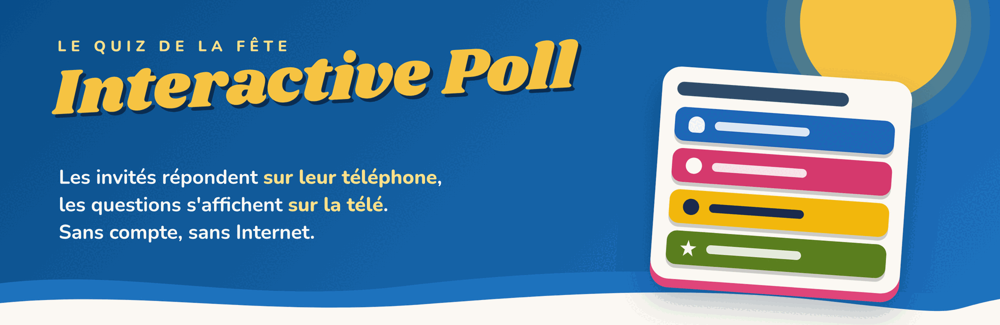
</p>

<p align="center">
  <a href="README.md">🇫🇷 Français</a> &nbsp;·&nbsp; 🇬🇧 <b>English</b>
</p>

<p align="center">
  
  
  
  
  
</p>

<h1 align="center">🎉 The quiz for your next party</h1>

<p align="center">
  Birthday, wedding, game night, family dinner…<br>
  <b>The TV shows the questions, everyone answers on their phone.</b><br>
  Scan a QR code, no app to install, and a podium at the end 🏆
</p>

<p align="center">
  <a href="https://github.com/will-44/interactive_poll/releases/latest">
    
  </a>
</p>

> [!NOTE]
> The app itself (buttons, labels) is in **French** only. Your own questions can be written in any language.

> [!WARNING]
> **Please read before using it** (in plain words, no tech background needed):
>
> - 🤖 This project was **entirely "vibe-coded" with Claude Opus** (an AI): nobody has reviewed the code line by line.
> - 🔓 **There is no security at all**: no password, no encryption. The admin page is open to **anyone on the same network** as the computer.
> - 🏠 So run it **preferably on a trusted local Wi-Fi** (your home router, with guests you know). **Never put it on the Internet.**
> - 🧾 No warranty: this is a project made for fun (see the license).

---

## 👀 What it looks like

<table>
  <tr>
    <td width="50%" align="center">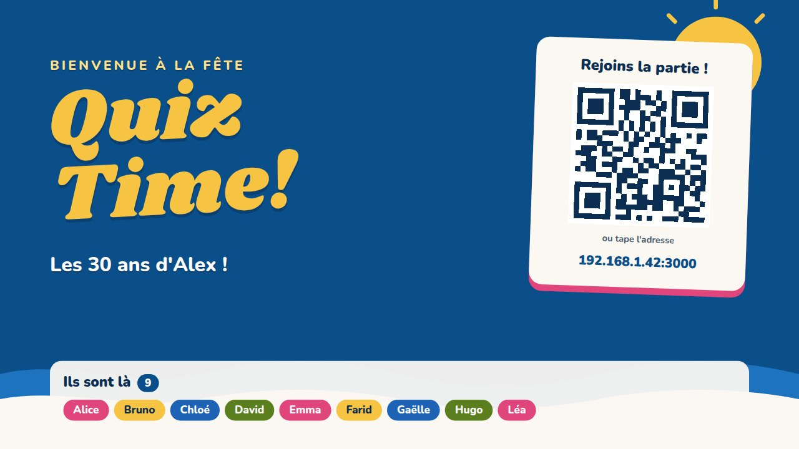<br><sub><b>📺 The TV</b>: guests scan the QR code</sub></td>
    <td width="50%" align="center">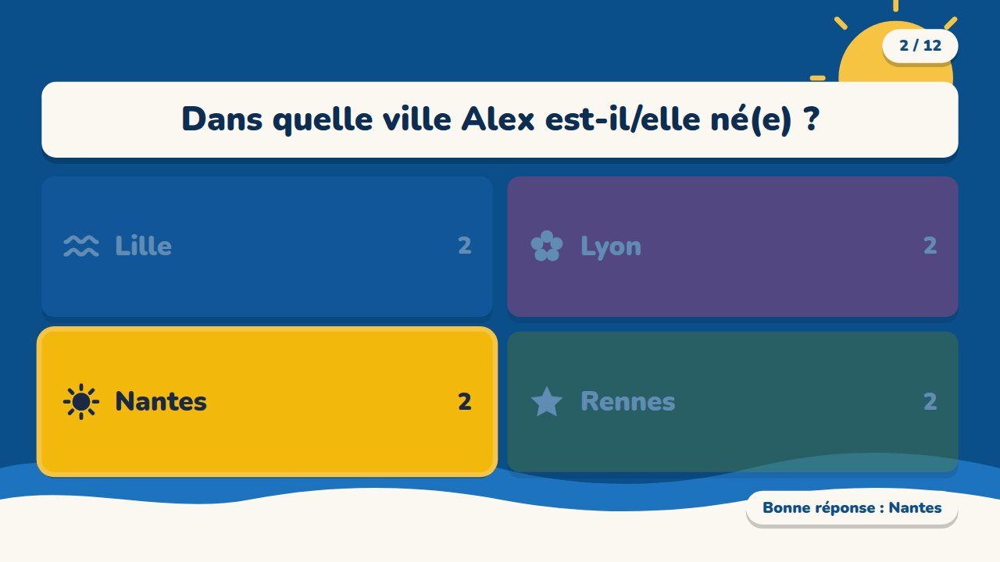<br><sub><b>📺 The TV</b>: the right answer is revealed</sub></td>
  </tr>
  <tr>
    <td colspan="2" align="center">
      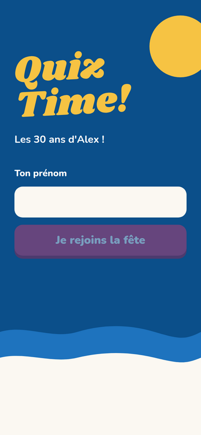
      &nbsp;
      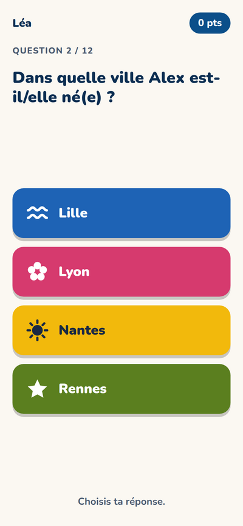
      &nbsp;
      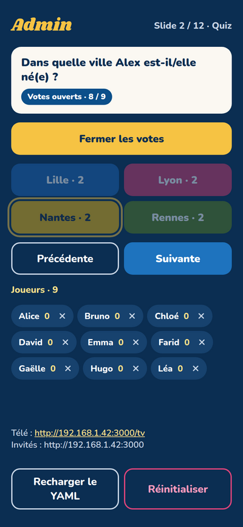
      <br><sub><b>📱 The phones</b>: join · answer · (right) the host's phone that drives the game</sub>
    </td>
  </tr>
  <tr>
    <td width="50%" align="center">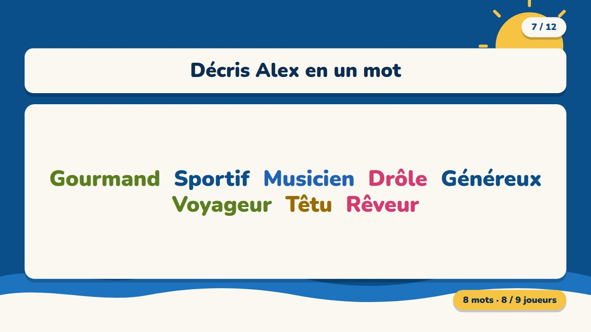<br><sub><b>☁️ Word cloud</b>: guests' answers pop up</sub></td>
    <td width="50%" align="center">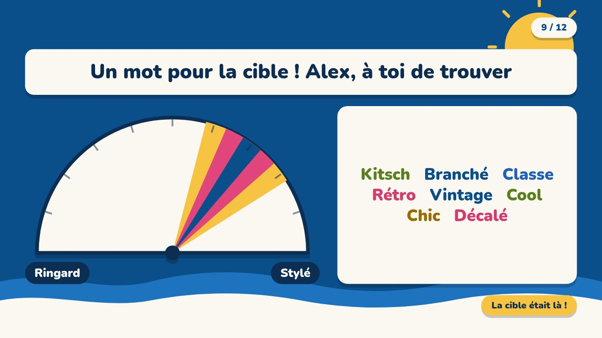<br><sub><b>🎯 Half-circle</b>: the target is revealed</sub></td>
  </tr>
  <tr>
    <td colspan="2" align="center">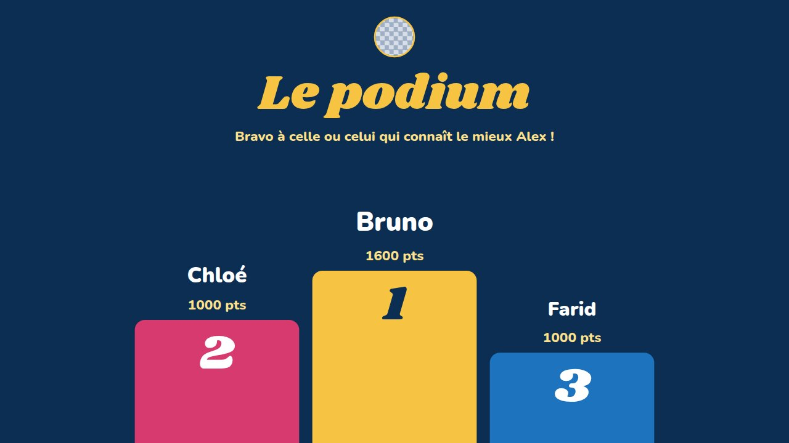<br><sub><b>🏆 The podium</b> at the end of the game</sub></td>
  </tr>
</table>

## 🎮 What you can ask

| | Question type | How it plays |
| :-: | --- | --- |
| 🧠 | **Quiz** | 2 to 4 possible answers, only one is right. Points for correct answers. |
| 🎚️ | **Slider** | "How many countries has Alex visited?": the closer to the right number, the more points. |
| 📊 | **Audience opinion** | Everyone moves a slider ("more A or more B?"). The TV shows the live average. No points. |
| ☁️ | **Word cloud** | "Describe Alex in one word": all the words appear big on the TV. |
| 🎯 | **Half-circle** | Guests see a secret target and type a word to describe it; the guest of honour has to guess where it is. |
| 🖼️ | **Content** | A welcome or transition screen: title, text, photo in a Polaroid frame. |

---

## 🚀 Getting started: 3 steps

1. **📥 Install** the program on the computer connected to the TV *(once and for all)*.
2. **✏️ Create your quiz** in the editor (a web page: no file to touch).
3. **▶️ Play**: start the program, show the TV page, scan the QR code.

---

## 📥 Step 1: install

### 🪟 On Windows

#### ⭐ Recommended: the installer

1. Download **`InteractivePoll-Setup-x.y.z.exe`** from the [Releases](https://github.com/will-44/interactive_poll/releases/latest) page (big blue button at the top of this page).
2. Double-click it and follow the steps. **Nothing to install beforehand**: everything is included, and the firewall is set up for you.
3. Done! Open **Interactive Poll** from the Start menu.

> [!NOTE]
> Windows may show a blue "*Windows protected your PC*" message: the program is not code-signed (that costs money). Click **More info**, then **Run anyway**.

> [!TIP]
> If Windows classifies your Wi-Fi as "**Public**", switch it to "**Private**" (Settings → Network & Internet → Wi-Fi → your network → *Private*). Otherwise the firewall will block the phones.

#### Alternative: the install script

1. Download the project: [**the ZIP file**](https://github.com/will-44/interactive_poll/archive/refs/heads/main.zip), then right-click → *Extract all*.
2. In the folder, double-click **`install-windows.bat`** and accept the permission prompt.
3. An **Interactive Poll** shortcut appears on your desktop.

The script installs what's missing (Node.js), sets up the firewall for private networks and offers to switch your Wi-Fi to "Private".

<details>
<summary>🛠️ <b>Manual install on Windows</b> (for the curious)</summary>

<br>

1. Install **Node.js LTS** from <https://nodejs.org> (`.msi` installer, default options).
2. Install **Git** from <https://git-scm.com/download/win> (or use the project ZIP).
3. Open **PowerShell** and type:

```powershell
node -v    # should print v18 or higher

git clone https://github.com/will-44/interactive_poll.git
cd interactive_poll
npm install
npm start
```

On first run, Windows shows a firewall alert for Node.js: tick **"Private networks"** then *Allow access*.

If PowerShell refuses `npm` ("execution policy"), use `cmd`, or run once: `Set-ExecutionPolicy -Scope CurrentUser RemoteSigned`.

</details>

### 🐧 On Ubuntu / Linux

Open a **terminal** (keys `Ctrl` + `Alt` + `T`), then copy-paste these lines:

```bash
sudo apt update && sudo apt install -y git
git clone https://github.com/will-44/interactive_poll.git
cd interactive_poll
./install-ubuntu.sh
```

The script installs Node.js if missing, prepares the program, opens port 3000 **for your local network only** (if the `ufw` firewall is active) and adds **Interactive Poll** to the applications menu.

<details>
<summary>🛠️ <b>Manual install on Ubuntu</b> (for the curious)</summary>

<br>

You need **Node.js 18 or newer** (22 LTS recommended) and git.

```bash
sudo apt update
sudo apt install -y git curl

# Node.js 22 LTS (via NodeSource)
curl -fsSL https://deb.nodesource.com/setup_22.x | sudo -E bash -
sudo apt install -y nodejs
node -v    # should print v18 or higher

git clone https://github.com/will-44/interactive_poll.git
cd interactive_poll
npm install
npm start

# Firewall, if it is enabled:
sudo ufw allow 3000/tcp
```

Without `sudo`: install Node with [nvm](https://github.com/nvm-sh/nvm) (`nvm install --lts`).

</details>

---

## ✏️ Step 2: create your quiz

When the program starts, your browser opens by itself on the **quiz editor** (otherwise: `http://localhost:3000/editor`). No file to edit, no code: everything is done by clicking. (The editor itself is in French, like the rest of the app.)

<p align="center">
  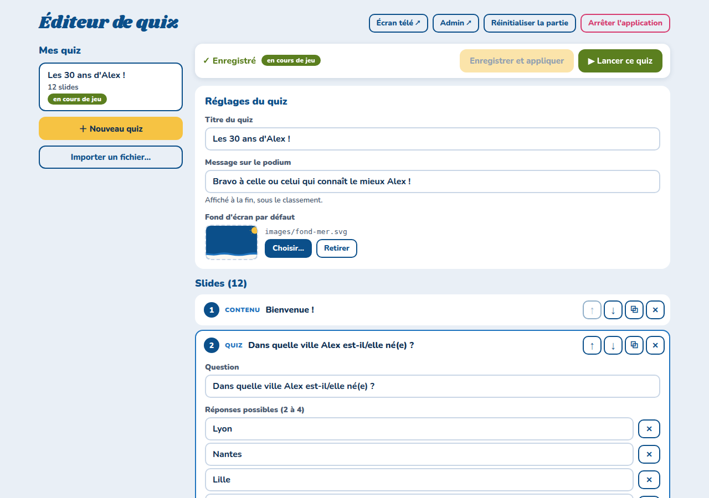
</p>

- **➕ Add a slide** ("Ajouter une slide"): quiz, slider, audience opinion, word cloud, half-circle or a plain text screen.
- **↑ ↓ ⧉ ✕**: move up, move down, duplicate or delete a slide.
- **🖼️ Photos**: *Choisir…* (choose) → *Ajouter une photo* (add a photo): JPG, PNG, GIF, WebP or SVG. iPhone HEIC photos are refused with a message: export them as JPG.
- **✅ Live checking**: a question without answers, a missing image… the editor tells you right away and refuses to save until it is fixed.
- **💾 Save** ("Enregistrer"): a copy of the previous version is kept next to it (`.yaml.bak` file).

### 📚 Several quizzes

Each quiz is a file in the `quizzes/` folder; the left column of the editor lists them. "Les 30 ans d'Alex" is a **complete example**: duplicate it for inspiration, or create an empty quiz with **Nouveau quiz** (new quiz). You can also **export** a quiz (YAML file) to give it to someone, or **import** someone else's: the editor then lists the photos to copy into the `images/` folder, because photos are not inside the file.

> [!WARNING]
> **"▶ Lancer ce quiz" (launch this quiz) starts a new game: the current game is reset** (players and scores erased). A confirmation message appears first. Phones that are already connected sign up again by themselves.
>
> By contrast, **"Enregistrer et appliquer"** (save and apply) on the quiz being played updates the questions **without erasing players or scores**: handy to fix a typo in the middle of the party. During a game, only fix texts: don't add, remove or move slides that were already played (answers would shift).

<p align="center">
  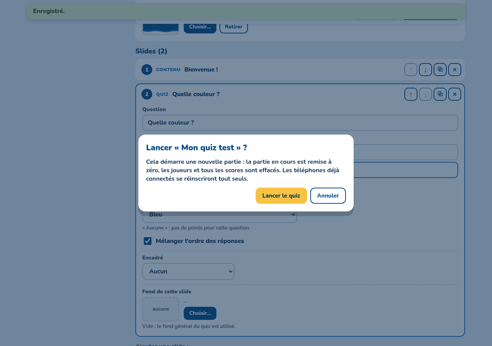
</p>

Top right of the editor: **Réinitialiser la partie** (reset the game: erases players and scores, keeps the same quiz) and **Arrêter l'application** (stop the app).

> [!NOTE]
> The editor can **only be opened from the computer running the program** (`localhost`): the guests' phones cannot open it. Where are my files? With the Windows installer: `C:\Program Files\Interactive Poll\quizzes` and `…\images` (**Images folder** shortcut in the Start menu). Otherwise: the `quizzes/` and `images/` folders of the project. Your quizzes are **not** sent to GitHub (git ignores them), only the example is.

### 🧑‍🎨 For the curious: a quiz file

A quiz is a plain text file (YAML): you can also edit it by hand with Notepad or gedit, then click **Recharger le YAML** (reload YAML) in the admin page. An old `slides.yaml` at the root of the program is imported automatically into `quizzes/` on first launch (the original is renamed `slides.yaml.importe`). The comments in the example file are in French; the keys such as `titre`, `texte`, `gauche`, `droite` must stay as they are.

> [!IMPORTANT]
> The file uses **spaces at the start of lines** to stay organised. Keep them as they are (no `Tab` key): copying an existing block and only changing the texts works fine.

Each question is a small block starting with a dash `-`. Here are the main ones:

```yaml
titre: "Alex's 30th birthday!"          # the title shown on the TV
background: images/fond-mer.svg         # the background image

slides:
  - type: quiz                          # 🧠 a quiz
    question: "Which city was Alex born in?"
    options: [Lyon, Marseille, Nantes, Lille]
    answer: Nantes                      # the right answer

  - type: slider                        # 🎚️ guess a number
    question: "How many countries has Alex visited?"
    min: 0
    max: 50
    answer: 12
    tolerance: 5                        # 0 points if off by more than 5
    unite: countries

  - type: wordcloud                     # ☁️ word cloud
    question: "Describe Alex in one word"
    max_mots: 3
```

<details>
<summary>📖 <b>All question types, with their options</b></summary>

<br>

```yaml
  - type: contenu                    # 🖼️ screen without a vote
    titre: "Welcome!"
    texte: "Get your phones out."
    cadre: { image: images/exemple-photo.svg }   # photo in a Polaroid frame

  - type: quiz
    question: "A question?"
    options: [A, B, C, D]            # 2 to 4 options
    answer: B                        # optional: otherwise you pick it in the admin
    melanger: non                    # optional: options are shuffled by default

  - type: slider
    question: "How many…?"
    min: 0
    max: 200
    unite: pairs
    tolerance: 30                    # 0 pts beyond ± 30
    background: images/fond-disco.svg
    cadre: { texte: "Hint: a lot." }

  - type: avis                       # 📊 audience opinion (no points)
    question: "Alex is more of a…"
    gauche: "Early bird"
    droite: "Night owl"              # scale 0–10 by default (min, max, step, unite)

  - type: wordcloud
    question: "Describe Alex in one word"
    max_mots: 3                      # or "illimité" (unlimited)

  - type: demicercle                 # 🎯 half-circle game (no points)
    gauche: "Cheesy"
    droite: "Cool"
    cible: 70                        # optional: 0 = left, 100 = right, otherwise random
```

- **Photos**: ideally 16:9. iPhone photos are often **HEIC**, which browsers cannot display: convert them to JPG first.
- **Bundled backgrounds**: `fond-mer.svg`, `fond-disco.svg`, `fond-chaux.svg`. Each slide can have its own `background`.
- **Copyright**: if you publish your version online, only use images you have the rights to.
- **Without `answer`**: after closing the votes, you pick the right answer yourself in the admin.
- **Half-circle**: guests see the target on their phone and type a word; the guest of honour shows on the TV where they think the target is. The first "Suivante" (next) reveals the target, the second moves on.
- `quizzes/exemple.yaml` is heavily commented at the top: that is the built-in help. When the editor saves a quiz, it replaces those comments with a short header.
- Your quizzes (`quizzes/*.yaml`) are ignored by git; your photos are not: if you publish your copy of the project, don't put private photos in `images/`.

</details>

> [!TIP]
> During the party, with the editor: **Enregistrer et appliquer**, that's all. If you edit the file by hand, use the **Recharger le YAML** (reload YAML) button in the admin page. On error (missing option, image not found…), the admin explains it and keeps the previous version.

---

## ▶️ Step 3: play

### Start the program

| Where | How |
| --- | --- |
| 🪟 **Windows** (installer) | Start menu → **Interactive Poll** |
| 🪟 **Windows** (script) | **Interactive Poll** shortcut on the desktop |
| 🐧 **Ubuntu** | Applications menu → **Interactive Poll**, or `./start-ubuntu.sh` |

A **black window** opens: that's normal, it runs the quiz and prints the addresses. **Don't close it during the game.** The browser opens at the same time on the editor: pick your quiz and click **▶ Lancer ce quiz**. (To stop the browser from opening automatically: `NO_BROWSER=1`, or the `--no-browser` option.)

> [!IMPORTANT]
> Connect the computer to the party's Wi-Fi **first**, **then** start the program: the QR code's address is computed at startup.

### The screens

| Screen | For whom | Address |
| --- | --- | --- |
| 📱 **Guests** | the guests' phones (they scan the QR code on the TV) | `http://<ip>:3000` |
| 📺 **TV** | the browser connected to the TV (full screen: `F11` key) | `http://<ip>:3000/tv` |
| 🎛️ **Admin** | the host's phone | `http://<ip>:3000/admin` |
| ✏️ **Editor** | the program's computer **only** | `http://localhost:3000/editor` |

`<ip>` is the computer's address; it is printed in the black window. Everyone must be on the **same Wi-Fi**. No Internet needed.

### 🎛️ Driving the game (admin)

- **Commencer / Suivante / Précédente** (start / next / previous): move between slides. Going back doesn't make people vote again.
- **Fermer les votes** (close votes), then **Révéler** (reveal) the right answer.
- **Points**: 1000 for a correct quiz answer; for sliders, from 1000 (exact value) down to 0 (beyond the tolerance). The podium appears after the last slide.
- **❌ next to a player**: removes them from the game.
- **Réinitialiser** (reset): wipes players and scores (handy after a rehearsal).

---

## 🆘 Something's wrong?

<details>
<summary>📵 <b>Phones cannot connect</b></summary>

<br>

- **Same Wi-Fi?** Phones and computer must be on the same network.
- **"Guest" Wi-Fi or client isolation**: some routers stop devices from seeing each other. Use the main Wi-Fi, or create a hotspot from the computer or a phone.
- **Firewall**: on Windows the network must be "Private" (see above); on Ubuntu, `sudo ufw allow 3000/tcp`.
- **Wrong address in the QR code**: the black window lists the other detected addresses. Restart with the right one:
  - Linux: `HOST_IP=192.168.1.42 npm start`
  - Windows (PowerShell): `$env:HOST_IP = "192.168.1.42"; npm start`
- **Different port**: `PORT=8080 npm start` (Linux) or `$env:PORT = 8080; npm start` (Windows).

</details>

<details>
<summary>✏️ <b>The editor does not open</b></summary>

<br>

- Open `http://localhost:3000/editor` by hand **on the computer running the program**. From another device (phone, other PC) the editor is deliberately refused.
- If you use another port (`PORT=8080`), replace `3000` with that port.
- "Image introuvable" (image not found): the image must be in the `images/` folder; use *Choisir… → Ajouter une photo* rather than copying the file by hand.

</details>

<details>
<summary>⚠️ <b>Windows refuses to run the script or the installer</b></summary>

<br>

- Blue "*Windows protected your PC*" message: **More info** → **Run anyway**.
- "Execution policy" error in PowerShell: run `install-windows.bat` (it works around it), or type once `Set-ExecutionPolicy -Scope CurrentUser RemoteSigned`.
- To undo the firewall setting: `Remove-NetFirewallRule -DisplayName 'Interactive Poll'` (PowerShell as administrator).

</details>

<details>
<summary>💥 <b>The computer crashed mid-game</b></summary>

<br>

Start the program again: the game resumes where it was (state is saved continuously in `data/state.json`). To start from scratch without the admin page, delete that file.

</details>

## 💡 Good to know

- A guest who reloads the page or whose phone goes to sleep **gets their spot and score back**.
- The `install-windows.*` and `install-ubuntu.sh` scripts are plain text files: read them before running them, they ask for administrator rights.

<details>
<summary>🧑‍💻 <b>For developers</b></summary>

<br>

- **Development**: `npm run dev` (hot reload on port 5173, the realtime server stays on 3000). Tests: `npm test`.
- **Editor**: HTTP API `/api/*` ([server/editor-api.js](server/editor-api.js)), restricted to `localhost` (caller address, `Host` header, `X-Requested-With` header on writes); quiz storage in [server/quizzes.js](server/quizzes.js).
- **Stack**: Node.js, Express, Socket.IO, React, Vite.
- **Windows installer**: the `.exe` is built by GitHub Actions ([release-windows.yml](.github/workflows/release-windows.yml), Inno Setup script in [installer/](installer/)) and tested automatically (silent install, then the server and the editor must respond). To publish a version:

  ```bash
  git tag v1.0.0
  git push origin v1.0.0
  ```

  `InteractivePoll-Setup-1.0.0.exe` then appears under Releases. The workflow can also be run manually from the *Actions* tab.

</details>

---

<p align="center">
  Made with ☀️ and a lot of <i>vibe coding</i> · <a href="LICENSE">GNU GPL v3</a> license · No warranty
</p>
