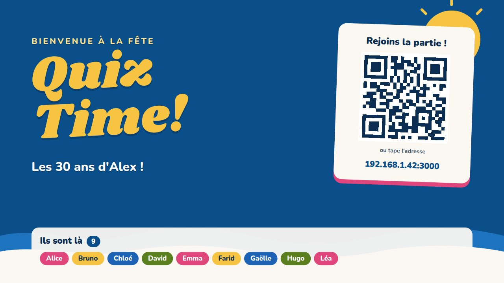
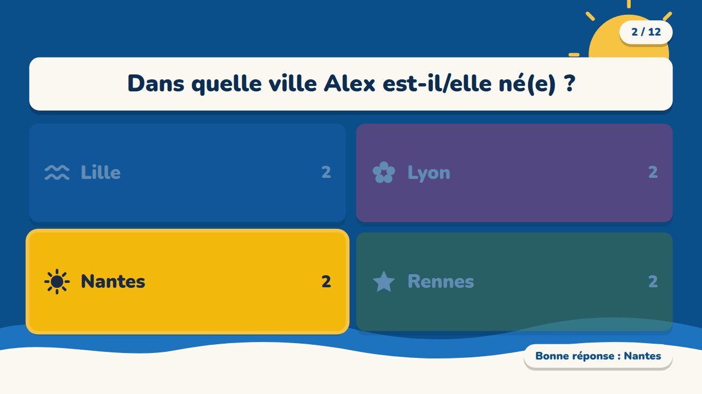
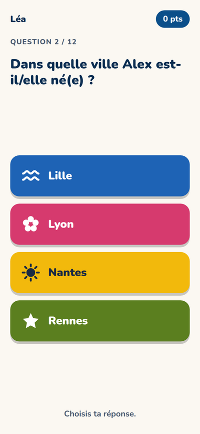
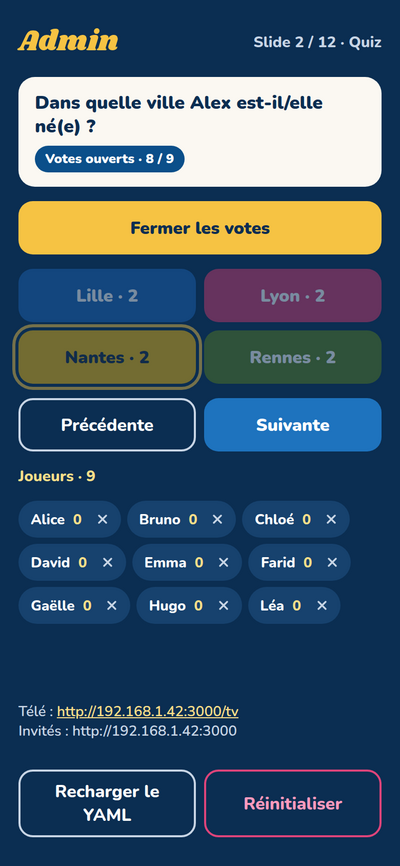
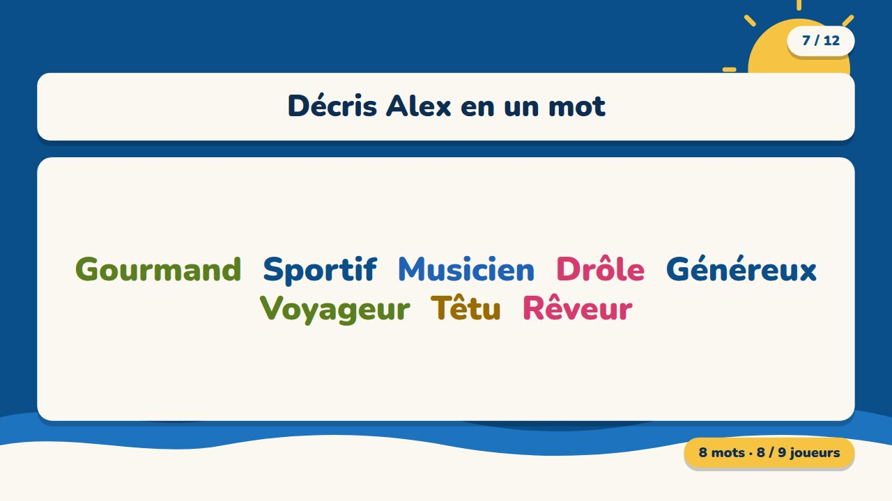
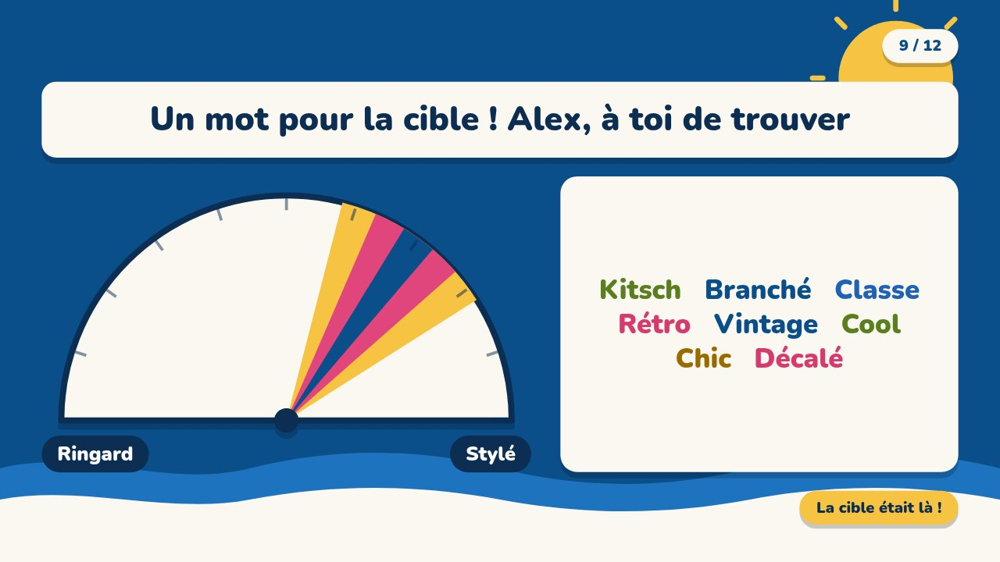
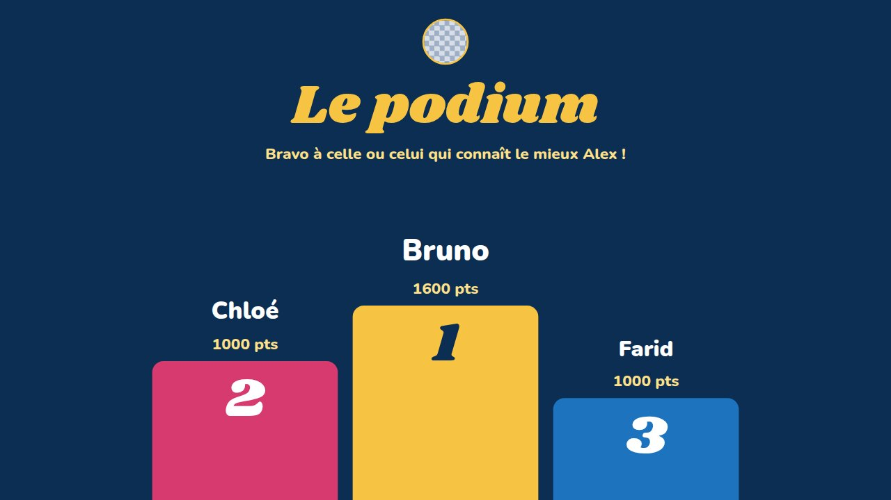

<p align="center">
  
</p>

<p align="center">
  🇫🇷 <b>Français</b> &nbsp;·&nbsp; <a href="README.en.md">🇬🇧 English</a>
</p>

<p align="center">
  
  
  
  
  
</p>

<h1 align="center">🎉 Le quiz de votre prochaine fête</h1>

<p align="center">
  Anniversaire, mariage, soirée entre amis, repas de famille…<br>
  <b>La télé affiche les questions, chacun répond avec son téléphone.</b><br>
  Un QR code à scanner, aucune application à installer, et un podium à la fin 🏆
</p>

<p align="center">
  <a href="https://github.com/will-44/interactive_poll/releases/latest">
    
  </a>
</p>

> [!WARNING]
> **À savoir avant de l'utiliser** (en clair, pas besoin d'être informaticien) :
>
> - 🤖 Ce projet a été **entièrement « vibe-codé » avec Claude Opus** (une IA) : personne n'a relu le code ligne par ligne.
> - 🔓 **Il n'y a aucune sécurité** : pas de mot de passe, pas de chiffrement. La page d'administration est accessible à **toute personne connectée au même réseau** que l'ordinateur.
> - 🏠 Utilisez-le donc **de préférence sur un Wi-Fi local de confiance** (votre box à la maison, avec des invités que vous connaissez). **Ne le mettez jamais sur Internet.**
> - 🧾 Aucune garantie : c'est un projet fait pour s'amuser (voir la licence).

---

## 👀 À quoi ça ressemble

<table>
  <tr>
    <td width="50%" align="center"><br><sub><b>📺 La télé</b> : les invités scannent le QR code</sub></td>
    <td width="50%" align="center"><br><sub><b>📺 La télé</b> : la bonne réponse est révélée</sub></td>
  </tr>
  <tr>
    <td colspan="2" align="center">
      
      &nbsp;
      
      &nbsp;
      
      <br><sub><b>📱 Les téléphones</b> : rejoindre · répondre · (à droite) le téléphone de l'animateur qui pilote la partie</sub>
    </td>
  </tr>
  <tr>
    <td width="50%" align="center"><br><sub><b>☁️ Nuage de mots</b> : les réponses des invités s'affichent</sub></td>
    <td width="50%" align="center"><br><sub><b>🎯 Demi-cercle</b> : la cible est révélée</sub></td>
  </tr>
  <tr>
    <td colspan="2" align="center"><br><sub><b>🏆 Le podium</b> à la fin de la partie</sub></td>
  </tr>
</table>

## 🎮 Ce que vous pouvez proposer

| | Type de question | Comment ça se passe |
| :-: | --- | --- |
| 🧠 | **Quiz** | 2 à 4 réponses possibles, une seule est bonne. Plus de points si on répond juste. |
| 🎚️ | **Curseur (slider)** | « Combien de pays a visité Alex ? » : plus on est proche du bon nombre, plus on gagne de points. |
| 📊 | **Avis du public** | Chacun place un curseur (« plutôt A ou plutôt B ? »). La télé affiche la moyenne en direct. Pas de points. |
| ☁️ | **Nuage de mots** | « Décris Alex en un mot » : tous les mots s'affichent en grand sur la télé. |
| 🎯 | **Demi-cercle** | Les invités voient une cible secrète et écrivent un mot pour la décrire ; la personne fêtée doit deviner où elle est. |
| 🖼️ | **Contenu** | Un écran d'accueil ou de transition : titre, texte, photo dans un cadre Polaroïd. |

---

## 🚀 Pour démarrer : 3 étapes

1. **📥 Installer** le programme sur l'ordinateur branché à la télé *(une fois pour toutes)*.
2. **✏️ Écrire vos questions** dans un fichier texte.
3. **▶️ Jouer** : lancer le programme, afficher la télé, scanner le QR code.

---

## 📥 Étape 1 : installer

### 🪟 Sur Windows

#### ⭐ Méthode recommandée : l'installeur

1. Téléchargez **`InteractivePoll-Setup-x.y.z.exe`** depuis la page [Releases](https://github.com/will-44/interactive_poll/releases/latest) (gros bouton bleu en haut de cette page).
2. Double-cliquez dessus et suivez les étapes. **Rien à installer avant** : tout est inclus, et le pare-feu est réglé pour vous.
3. C'est prêt ! Ouvrez **Interactive Poll** depuis le menu Démarrer.

> [!NOTE]
> Windows peut afficher un message bleu « *Windows a protégé votre PC* » : le programme n'est pas signé (c'est payant). Cliquez sur **Informations complémentaires**, puis **Exécuter quand même**.

> [!TIP]
> Si votre Wi-Fi est classé « **Public** » par Windows, passez-le en « **Privé** » (Paramètres → Réseau et Internet → Wi-Fi → votre réseau → *Privé*). Sinon, le pare-feu bloquera les téléphones.

#### Autre méthode : le script d'installation

1. Téléchargez le projet : [**le fichier ZIP**](https://github.com/will-44/interactive_poll/archive/refs/heads/main.zip), puis clic droit → *Extraire tout*.
2. Dans le dossier, double-cliquez sur **`install-windows.bat`** et acceptez la demande d'autorisation.
3. Un raccourci **Interactive Poll** apparaît sur le bureau.

Le script installe tout seul ce qui manque (Node.js), règle le pare-feu pour les réseaux privés et propose de passer votre Wi-Fi en « Privé ».

<details>
<summary>🛠️ <b>Installation manuelle sous Windows</b> (pour les curieux)</summary>

<br>

1. Installez **Node.js LTS** depuis <https://nodejs.org> (installeur `.msi`, options par défaut).
2. Installez **Git** depuis <https://git-scm.com/download/win> (ou utilisez le ZIP du projet).
3. Ouvrez **PowerShell** et tapez :

```powershell
node -v    # doit afficher v18 ou plus

git clone https://github.com/will-44/interactive_poll.git
cd interactive_poll
npm install
npm start
```

Au premier lancement, Windows affiche une alerte du pare-feu pour Node.js : cochez **« Réseaux privés »** puis *Autoriser l'accès*.

Si PowerShell refuse `npm` (« stratégie d'exécution »), utilisez `cmd`, ou tapez une fois : `Set-ExecutionPolicy -Scope CurrentUser RemoteSigned`.

</details>

### 🐧 Sur Ubuntu / Linux

Ouvrez un **terminal** (touches `Ctrl` + `Alt` + `T`), puis copiez-collez ces lignes :

```bash
sudo apt update && sudo apt install -y git
git clone https://github.com/will-44/interactive_poll.git
cd interactive_poll
./install-ubuntu.sh
```

Le script installe Node.js s'il manque, prépare le programme, ouvre le port 3000 **uniquement pour votre réseau local** (si le pare-feu `ufw` est actif) et ajoute **Interactive Poll** au menu des applications.

<details>
<summary>🛠️ <b>Installation manuelle sous Ubuntu</b> (pour les curieux)</summary>

<br>

Il faut **Node.js 18 ou plus récent** (22 LTS recommandé) et git.

```bash
sudo apt update
sudo apt install -y git curl

# Node.js 22 LTS (via NodeSource)
curl -fsSL https://deb.nodesource.com/setup_22.x | sudo -E bash -
sudo apt install -y nodejs
node -v    # doit afficher v18 ou plus

git clone https://github.com/will-44/interactive_poll.git
cd interactive_poll
npm install
npm start

# Pare-feu, s'il est actif :
sudo ufw allow 3000/tcp
```

Sans `sudo` : installez Node avec [nvm](https://github.com/nvm-sh/nvm) (`nvm install --lts`).

</details>

---

## ✏️ Étape 2 : écrire vos questions

Toutes les questions sont dans **un simple fichier texte** nommé [`slides.yaml`](slides.yaml). Le fichier fourni est un **exemple complet** (« Les 30 ans d'Alex ») : modifiez-le avec votre propre histoire.

- **Installeur Windows** : menu Démarrer → Interactive Poll → **Modifier les slides** (ouvre le Bloc-notes). Vos photos vont dans **Dossier des images**.
- **Autres cas** : ouvrez `slides.yaml` avec n'importe quel éditeur de texte (Bloc-notes, gedit…). Vos photos vont dans le dossier [`images/`](images/).

> [!IMPORTANT]
> Le fichier utilise des **espaces au début des lignes** pour s'organiser. Gardez-les tels quels (pas de touche `Tab`) : en recopiant un bloc existant et en changeant seulement les textes, tout se passe bien.

Chaque question est un petit bloc qui commence par un tiret `-`. Voici à quoi ressemblent les principaux :

```yaml
titre: "Les 30 ans d'Alex !"            # le titre affiché sur la télé
background: images/fond-mer.svg         # l'image de fond

slides:
  - type: quiz                          # 🧠 un quiz
    question: "Dans quelle ville Alex est-il/elle né(e) ?"
    options: [Lyon, Marseille, Nantes, Lille]
    answer: Nantes                      # la bonne réponse

  - type: slider                        # 🎚️ deviner un nombre
    question: "Combien de pays Alex a-t-il/elle visités ?"
    min: 0
    max: 50
    answer: 12
    tolerance: 5                        # 0 point si l'écart dépasse 5
    unite: pays

  - type: wordcloud                     # ☁️ nuage de mots
    question: "Décris Alex en un mot"
    max_mots: 3
```

<details>
<summary>📖 <b>Tous les types de questions, avec leurs options</b></summary>

<br>

```yaml
  - type: contenu                    # 🖼️ écran sans vote
    titre: "Bienvenue !"
    texte: "Sortez vos téléphones."
    cadre: { image: images/exemple-photo.svg }   # photo dans un cadre Polaroïd

  - type: quiz
    question: "Une question ?"
    options: [A, B, C, D]            # 2 à 4 options
    answer: B                        # facultatif : sinon vous choisissez dans l'admin
    melanger: non                    # facultatif : par défaut les options sont mélangées

  - type: slider
    question: "Combien… ?"
    min: 0
    max: 200
    unite: paires
    tolerance: 30                    # 0 pt au-delà de ± 30
    background: images/fond-disco.svg
    cadre: { texte: "Indice : beaucoup." }

  - type: avis                       # 📊 avis du public (pas de points)
    question: "Alex est plutôt…"
    gauche: "Lève-tôt"
    droite: "Couche-tard"            # échelle 0–10 par défaut (min, max, step, unite)

  - type: wordcloud
    question: "Décris Alex en un mot"
    max_mots: 3                      # ou « illimité »

  - type: demicercle                 # 🎯 jeu du demi-cercle (pas de points)
    gauche: "Ringard"
    droite: "Stylé"
    cible: 70                        # facultatif : 0 = gauche, 100 = droite, sinon au hasard
```

- **Photos** : mettez-les dans le dossier des images (idéalement en 16:9). Les photos d'iPhone sont souvent au format **HEIC**, que le navigateur ne sait pas afficher : convertissez-les en JPG d'abord.
- **Fonds fournis** : `fond-mer.svg`, `fond-disco.svg`, `fond-chaux.svg`. Chaque slide peut avoir son propre `background`.
- **Droits d'auteur** : si vous publiez votre version sur Internet, n'utilisez que des images dont vous avez les droits.
- **Sans `answer`** : après la fermeture des votes, c'est vous qui choisissez la bonne réponse dans l'admin.
- **Demi-cercle** : les invités voient la cible sur leur téléphone et écrivent un mot ; la personne fêtée montre sur la télé où elle pense que la cible se trouve. Le premier « Suivante » révèle la cible, le second passe à la suite.
- Le fichier est abondamment commenté en haut : c'est l'aide intégrée.
- Pour garder vos vraies questions **hors de git**, mettez-les dans `slides.perso.yaml` (et vos photos dans `images/perso/`), puis lancez avec `SLIDES=slides.perso.yaml npm start` (Windows PowerShell : `$env:SLIDES = "slides.perso.yaml"; npm start`).

</details>

> [!TIP]
> Pendant la fête, après avoir modifié le fichier : bouton **Recharger le YAML** dans l'admin. En cas d'erreur (option manquante, image introuvable…), l'admin l'explique et garde l'ancienne version.

---

## ▶️ Étape 3 : jouer

### Lancer le programme

| Où | Comment |
| --- | --- |
| 🪟 **Windows** (installeur) | Menu Démarrer → **Interactive Poll** |
| 🪟 **Windows** (script) | Raccourci **Interactive Poll** sur le bureau |
| 🐧 **Ubuntu** | Menu des applications → **Interactive Poll**, ou `./start-ubuntu.sh` |

Une **fenêtre noire** s'ouvre : c'est normal, elle fait tourner le quiz et affiche les adresses. **Ne la fermez pas pendant la partie.**

> [!IMPORTANT]
> Connectez **d'abord** l'ordinateur au Wi-Fi de la fête, **puis** lancez le programme : l'adresse du QR code est calculée au démarrage.

### Les trois écrans

| Écran | Pour qui | Adresse |
| --- | --- | --- |
| 📱 **Invités** | les téléphones des invités (ils scannent le QR code de la télé) | `http://<ip>:3000` |
| 📺 **Télé** | le navigateur branché sur la télé (plein écran : touche `F11`) | `http://<ip>:3000/tv` |
| 🎛️ **Admin** | le téléphone de l'animateur | `http://<ip>:3000/admin` |

`<ip>` est l'adresse de l'ordinateur ; elle est affichée dans la fenêtre noire. Tout le monde doit être sur le **même Wi-Fi**. Internet n'est pas nécessaire.

### 🎛️ Piloter la partie (admin)

- **Commencer / Suivante / Précédente** : naviguer entre les slides. Revenir en arrière ne fait pas revoter.
- **Fermer les votes**, puis **Révéler** la bonne réponse.
- **Points** : 1000 pour une bonne réponse au quiz ; au slider, de 1000 (valeur exacte) à 0 (au-delà de la tolérance). Le podium s'affiche après la dernière slide.
- **❌ à côté d'un joueur** : le retire de la partie.
- **Réinitialiser** : efface joueurs et scores (pratique après une répétition).

---

## 🆘 Ça ne marche pas ?

<details>
<summary>📵 <b>Les téléphones n'arrivent pas à se connecter</b></summary>

<br>

- **Même Wi-Fi ?** Les téléphones et l'ordinateur doivent être sur le même réseau.
- **Wi-Fi « invités » ou isolation** : certaines box empêchent les appareils de se voir entre eux. Utilisez le Wi-Fi principal, ou créez un point d'accès depuis l'ordinateur ou un téléphone.
- **Pare-feu** : sous Windows, le réseau doit être « Privé » (voir plus haut) ; sous Ubuntu, `sudo ufw allow 3000/tcp`.
- **Mauvaise adresse dans le QR code** : la fenêtre noire liste les autres adresses détectées. Relancez avec la bonne :
  - Linux : `HOST_IP=192.168.1.42 npm start`
  - Windows (PowerShell) : `$env:HOST_IP = "192.168.1.42"; npm start`
- **Autre port** : `PORT=8080 npm start` (Linux) ou `$env:PORT = 8080; npm start` (Windows).

</details>

<details>
<summary>⚠️ <b>Windows refuse de lancer le script ou l'installeur</b></summary>

<br>

- Message bleu « *Windows a protégé votre PC* » : **Informations complémentaires** → **Exécuter quand même**.
- Erreur de « stratégie d'exécution » dans PowerShell : lancez `install-windows.bat` (il contourne le problème), ou tapez une fois `Set-ExecutionPolicy -Scope CurrentUser RemoteSigned`.
- Annuler le réglage du pare-feu : `Remove-NetFirewallRule -DisplayName 'Interactive Poll'` (PowerShell en administrateur).

</details>

<details>
<summary>💥 <b>L'ordinateur a planté en pleine partie</b></summary>

<br>

Relancez le programme : la partie reprend où elle en était (l'état est sauvegardé en continu dans `data/state.json`). Pour repartir de zéro sans passer par l'admin, supprimez ce fichier.

</details>

## 💡 Bon à savoir

- Un invité qui recharge la page ou dont le téléphone se met en veille **retrouve sa place et son score**.
- L'application est **en français** uniquement.
- Les scripts `install-windows.*` et `install-ubuntu.sh` sont de simples fichiers texte : relisez-les avant de les lancer, ils demandent les droits administrateur.

<details>
<summary>🧑‍💻 <b>Pour les développeurs</b></summary>

<br>

- **Développement** : `npm run dev` (rechargement à chaud sur le port 5173, le serveur temps réel reste sur 3000).
- **Technologies** : Node.js, Express, Socket.IO, React, Vite.
- **Installeur Windows** : le `.exe` est construit par GitHub Actions ([release-windows.yml](.github/workflows/release-windows.yml), script Inno Setup dans [installer/](installer/)) et testé automatiquement (installation silencieuse, puis le serveur doit répondre). Pour publier une version :

  ```bash
  git tag v1.0.0
  git push origin v1.0.0
  ```

  Le fichier `InteractivePoll-Setup-1.0.0.exe` apparaît alors dans les Releases. Le workflow peut aussi être lancé à la main depuis l'onglet *Actions*.

</details>

---

<p align="center">
  Fait avec ☀️ et beaucoup de <i>vibe coding</i> · Licence <a href="LICENSE">GNU GPL v3</a> · Aucune garantie
</p>
